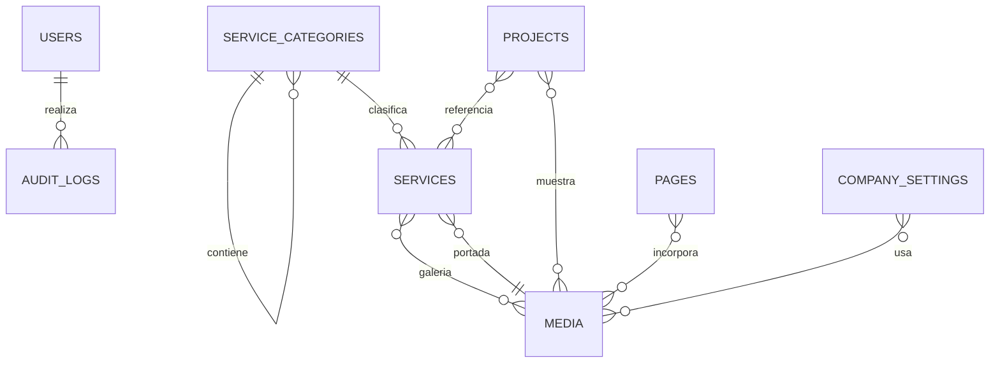

# Modelo lógico de base de datos — PostgreSQL + Payload

**Importante:** las tablas físicas, versiones y relaciones técnicas se generarán mediante el adaptador PostgreSQL de Payload CMS. Los nombres siguientes representan **entidades lógicas**; tablas de campos localizados y relaciones pueden tener nombres distintos.

## Convenciones
- ID interno estable (UUID cuando la configuración del adaptador lo permita; de lo contrario ID nativo Payload).
- `createdAt`, `updatedAt` automáticos.
- `status` o `_status`: `draft` / `published` según integración con versiones Payload; `archived` se manejará como campo/regla propia cuando aplique.
- Campos localizados: `title`, `slug`, `summary`, `description`, `seoTitle`, `seoDescription`.

## Entidades / colecciones

### users
`id`, `email` (único), `password` (hash gestionado por Payload Auth), `name`, `role` (solo `admin` en V1, ampliable), `active`, `createdAt`, `updatedAt`.
Reglas: email único; no devolver información confidencial a visitantes; operaciones administrativas restringidas.

### media
`id`, `filename`, `mimeType`, `filesize`, `width`, `height`, `url` (campos gestionados por upload), `alt` (localizado), `credit`, `createdAt`, `updatedAt`.
Reglas: formatos y tamaño permitidos, no borrar archivos referenciados sin comprobación.

### service_categories
`id`, `name` (localizado), `slug` (localizado), `description` (localizado), `parent` (FK opcional a service_categories), `image` (FK opcional a media), `sortOrder`, `active`, `createdAt`, `updatedAt`.
Reglas: no ciclos en padre/hijo; slug único según ámbito e idioma; categorías inactivas excluidas de vistas públicas.

### services
`id`, `title` (localizado), `slug` (localizado), `summary` (localizado), `description` (rich text localizado), `benefits` (lista localizada), `category` (FK service_categories), `coverImage` (FK media), `gallery` (M:N media), `featured`, `sortOrder`, `_status` (si drafts), `seoTitle` (localizado), `seoDescription` (localizado), `createdAt`, `updatedAt`.
Reglas: categoría, portada y título obligatorios al publicar; sin precios.

### projects
`id`, `title` (localizado), `slug` (localizado), `summary` (localizado), `description` (localizado), `services` (M:N services), `media` (M:N media), `featured`, `completedAt` (opcional), `_status`, `createdAt`, `updatedAt`.
No inventar nombres reales de clientes ni publicar imágenes sin autorización.

### pages
`id`, `title` (localizado), `slug` (localizado), `layout` (lista de bloques), `seoTitle`, `seoDescription`, `_status`, `createdAt`, `updatedAt`.
Páginas editables: inicio y páginas informativas según alcance aprobado.

### company_settings (Global único)
`legalName`, `tradeName`, `logo` (FK media), `phone`, `whatsapp`, `email`, `address`, `postalCode`, `city`, `country`, `hours` (estructura), `socialLinks`, `about` (localizado), `updatedAt`.

### site_settings (Global único)
`defaultLocale`, `enabledLocales`, `seoDefaults`, `whatsappDefaultMessage` (localizado), `favicon` (FK media), `updatedAt`.

### navigation (Global único)
`headerLinks` (grupo de links/localizados), `footerLinks`, `footerText` (localizado), `updatedAt`.

### audit_logs (opcional V1, por confirmar)
`id`, `actor` (FK users), `action`, `collection`, `recordId`, `metadata` (JSON con información no sensible), `createdAt`.

## Diagrama ER lógico simplificado

## Índices y restricciones
- `users.email`: único.
- `services.slug` y `service_categories.slug`: unicidad lógica por idioma y ruta; validar cómo expresa Payload índices localizados antes de generar migraciones.
- `services.category`, `services.featured`, `services._status` para consultas públicas.
- `projects._status`, `projects.featured`.
- Evitar eliminación de categorías con servicios activos y de archivos referenciados.

## Migraciones y backups
- Desarrollo: cambios modelados en colecciones Payload.
- Producción: ejecutar migraciones revisadas y respaldos automáticos.
- Probar restauración antes de lanzamiento.

## Pendiente de validación
- Colecciones definitivas, datos reales y campos legales.
- Tabla propia de permisos solo si no bastan roles fijos.
- Historia de slugs/redirecciones y auditoría extendida.
